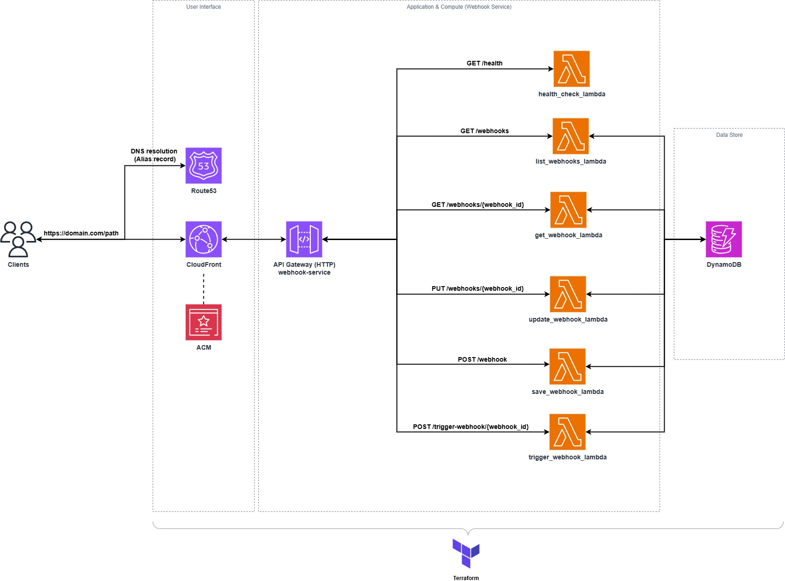

# Webhook Service

Automatic Preview regression tests for Webhook are paused. The pull request
workflow still deploys Preview and checks API readiness. Set the repository
Actions variable `ENABLE_WEBHOOK_PREVIEW_REGRESSION` to `true` to run Newman
followed by Bruno after the Preview API is ready.
